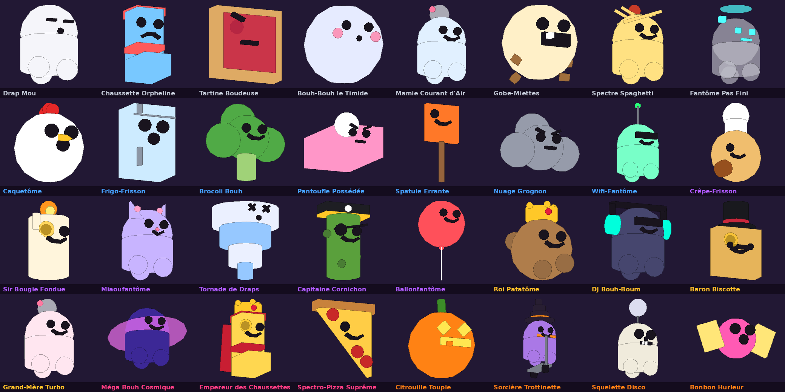

# Steal a Ghost

Jeu Roblox multijoueur (8 à 12 joueurs) sur le thème d'Halloween, version cartoon. On achète des fantômes absurdes sur un chemin hanté et on les pose dans sa base (5 socles à gauche, 5 à droite, plus un étage à acheter). Ils fabriquent des pièces qu'il faut venir ramasser sur les plaques vertes, et on peut aller voler les fantômes des autres.

Tout le jeu est écrit en Luau dans le dossier `src/`. La map, les fantômes et l'interface sont générés par le code au lancement : il n'y a rien à construire à la main dans Studio.



*(aperçu approximatif généré hors de Roblox, le rendu en jeu est plus propre)*

## Ouvrir le jeu dans Roblox Studio (méthode simple)

1. Installe Roblox Studio (gratuit) depuis https://create.roblox.com et connecte-toi avec ton compte Roblox.
2. Sur GitHub, ouvre le fichier `build/StealAGhost.rbxlx` puis clique sur le bouton de téléchargement ("Download raw file").
3. Double-clique sur le fichier téléchargé. S'il ne s'ouvre pas tout seul : dans Studio, menu Fichier > Ouvrir depuis un fichier (File > Open from File).
4. Clique sur Jouer (Play) ou appuie sur F5. Au bout de quelques secondes, tu apparais dans ta base avec ton premier fantôme.

À chaque nouvelle version que je pousse, il suffit de retélécharger ce fichier.

## Publier une première fois (obligatoire pour les sauvegardes)

Les sauvegardes Roblox (DataStore) ne marchent que sur un jeu publié.

1. Dans Studio : Fichier > Publier sur Roblox (File > Publish to Roblox). Donne le nom "Steal a Ghost", laisse le jeu en privé pour l'instant.
2. Accueil > Paramètres du jeu (Game Settings) > Sécurité (Security) : active "Enable Studio Access to API Services". Clique sur Enregistrer.
3. Toujours dans Paramètres du jeu > Places : mets le nombre maximum de joueurs à 12 (une base par joueur).

Sans ça, le jeu fonctionne quand même dans Studio, mais rien n'est sauvegardé. Un message l'indique dans la fenêtre Sortie (Output).

Pour publier une nouvelle version plus tard : ouvre le nouveau fichier `.rbxlx`, puis Fichier > Publier sur Roblox en tant que... (Publish to Roblox As) et choisis ton jeu existant. Les sauvegardes des joueurs ne sont pas touchées.

## Méthode Rojo (optionnelle, pour suivre les modifications en direct)

Rojo synchronise les fichiers du dossier `src/` avec Studio pendant que tu travailles. Pratique si tu veux modifier le code toi-même.

1. Installe Visual Studio Code (gratuit) et l'extension "Rojo - Roblox Studio Sync".
2. Clone ce dépôt sur ton ordinateur (GitHub Desktop le fait en deux clics).
3. Dans VS Code, ouvre le dossier du projet. Clique sur "Rojo" en bas de la fenêtre, installe le plugin Studio quand il le propose, puis lance `default.project.json`.
4. Dans Studio, ouvre ton jeu, onglet Plugins > Rojo > Connect.

## Où changer les réglages

Presque tout se règle dans `src/ReplicatedStorage/Shared/Config.luau` : prix, durées du verrou, fréquence de la Nuit Hantée, récompenses quotidiennes, IDs des Game Passes. Chaque ligne est commentée en français.

Les fantômes (noms, prix, revenus, apparence) sont dans `GhostData.luau`, les textes du jeu en français et en anglais dans `Strings.luau`, les sons dans `Sounds.luau`.

## Organisation du code

```
src/
  ReplicatedStorage/Shared/      partagé serveur + joueurs
    Config, GhostData, Rarities, Strings, Sounds, Format, Remotes
    GhostFactory                 fabrique les fantômes 3D
  ServerScriptService/
    Main.server.luau             démarre tout
    Services/                    toute la logique importante (anti-triche)
      DataService                sauvegarde
      MapBuilder                 construit la map
      BaseService                bases, socles, étage 2, ascenseur, verrou
      EconomyService             pièces, récolte sur les plaques, achat de l'étage, amis, hors ligne, cadeau du jour
      GhostService               chemin hanté, achat, vente
      StealService               vol, porteur, Marteau Pouet
      NightService               Nuit Hantée et Gloutrouille
      RebirthService             rebirth
      MonetizationService        Game Passes et pack de pièces
      IndexService               Fantômédex (collection et récompenses)
      CodeService                codes promo
      LeaderboardService         classement des voleurs de la semaine
      MissionService             missions du jour
      Hooks                      événements partagés entre services (achat, vol...)
      AnnounceService            messages et annonces
      Guard                      vérifications anti-triche
  StarterPlayer/StarterPlayerScripts/
    Client.client.luau           démarre l'affichage côté joueur
    Controllers/                 HUD, panneaux, tutoriel, nuit, bases, chemin, voleurs, effets
```

Le serveur décide de tout (argent, achats, vols). Les joueurs envoient seulement des demandes, que le serveur vérifie une par une.

## Vérifier le code (pour les développeurs)

Le projet se vérifie hors de Roblox avec [Lune](https://github.com/lune-org/lune) et [Selene](https://github.com/Kampfkarren/selene) :

```
lune run tests/compile.luau      # compile chaque fichier
lune run tests/run.luau          # données, textes FR/EN, construction des fantômes et de la map
lune run tests/sim.luau          # parties complètes jouées par le vrai code serveur
lune run tests/client_sim.luau   # pareil avec le vrai code client (HUD, tutoriel, panneaux...)
selene src tests tools           # analyse du code
rojo build default.project.json -o build/StealAGhost.rbxlx
```

`tests/fakeroblox.luau` est un mini Roblox simulé (joueurs, sauvegarde en mémoire, temps accéléré). Il fait tourner le vrai code du jeu et vérifie chaque propriété Roblox utilisée avec la base officielle des classes. Il ne remplace pas un test dans Studio, mais il attrape la plupart des erreurs avant.

## Les autres guides

- [docs/TEST.md](docs/TEST.md) : tester dans Studio, à plusieurs joueurs et sur un écran de téléphone
- [docs/PUBLICATION.md](docs/PUBLICATION.md) : checklist de publication, questionnaire de maturité, description, icône et miniatures, règles 2026 pour les 9-15 ans
- [docs/CROISSANCE.md](docs/CROISSANCE.md) : 5 vidéos TikTok/Shorts à filmer et le plan des 4 semaines après Halloween
